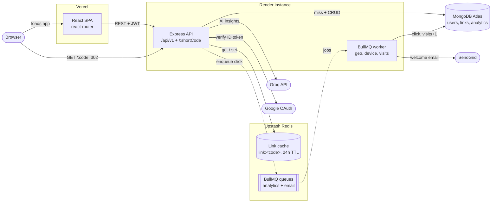
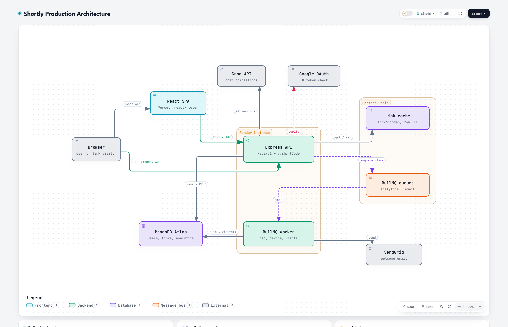

# Architecture

Production setup of Shortly. The diagram below is text (Mermaid), so GitHub renders it and tools can read it; the PNG at the end is the same picture for slides or the README.

## Components

| Component | Runs on | Role | Code |
|---|---|---|---|
| React SPA | Vercel | Dashboard, link analytics, auth screens. All API calls go through `request()` with a `Bearer` token. Unknown paths rewrite to `index.html` (`client/vercel.json`). | `client/src/App.jsx`, `client/src/api.js` |
| Express API | Render | REST API under `/api/v1`, plus the `GET /:shortCode` redirect. | `server/src/app.js` |
| BullMQ worker | Render (same instance, `start:with-worker`) | Writes click analytics and sends welcome emails, off the request path. | `server/src/worker.js`, `server/src/infrastructure/queue/` |
| Link cache | Upstash Redis | Cache-aside for redirects: `link:<code>`, 24h TTL. Fails open with a 250 ms timeout, so a Redis outage falls back to MongoDB. | `server/src/infrastructure/cache/linkCache.js` |
| BullMQ queues | Upstash Redis | `analyticsQueue` (3 attempts, exponential backoff) and `emailQueue`. | `server/src/infrastructure/queue/` |
| MongoDB | Atlas | Users, links and one analytics document per click. | `server/src/domains/*/*.model.js` |
| Groq | external | Dashboard insight, link name suggestions, per-link summary and audience, and Ask AI. | `server/src/domains/ai/` |
| Google OAuth | external | Verifies Google ID tokens; the API then issues the same JWTs as email login. | `server/src/domains/user/googleAuth.service.js` |
| SendGrid | external | Welcome emails, sent by the worker. | `server/src/infrastructure/utils/email.utils.js` |

## Redirect path

1. `GET /:shortCode` looks up `link:<code>` in Redis, and falls back to MongoDB on a miss (then caches it).
2. The click is added to `analyticsQueue` without awaiting, and the API responds with a 302 right away.
3. The worker resolves country (geoip) and browser, OS and device (user agent), saves the click and increments `visits`.

Redis uses two connections with opposite settings (see [`server/docs/redis-flow.md`](../server/docs/redis-flow.md)): BullMQ's retries forever, the cache's fails fast.

## Local setup

`docker-compose.yml` runs the same pieces locally: `mongo:7` and `redis:7-alpine` replace Atlas and Upstash, the API and worker run as separate containers from one image, and nginx serves the built SPA and proxies `/api` and `/health` to the API. See [docker.md](docker.md).

## Image

