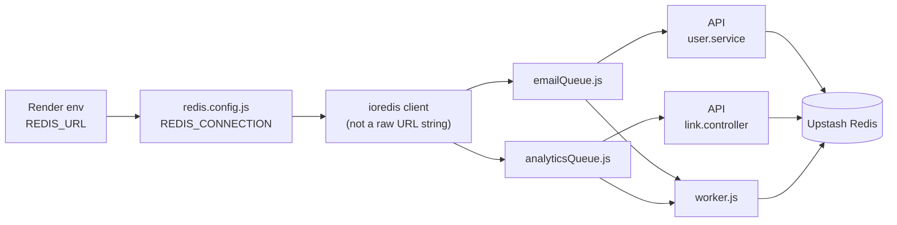

# Redis in Shortly

Redis is only used for **BullMQ job queues** (not link storage).

| File | Purpose |
|------|---------|
| `src/config/server.config.js` | Reads env vars |
| `src/config/redis.config.js` | Builds `REDIS_CONNECTION` |
| `src/infrastructure/queue/*.js` | BullMQ queues + workers |
| `src/worker.js` | Processes jobs |
